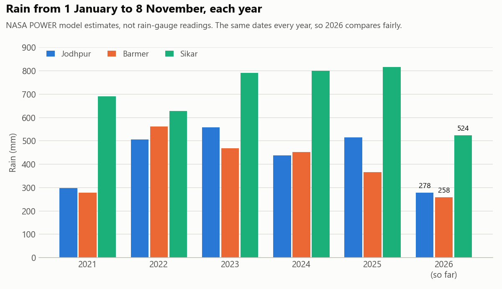
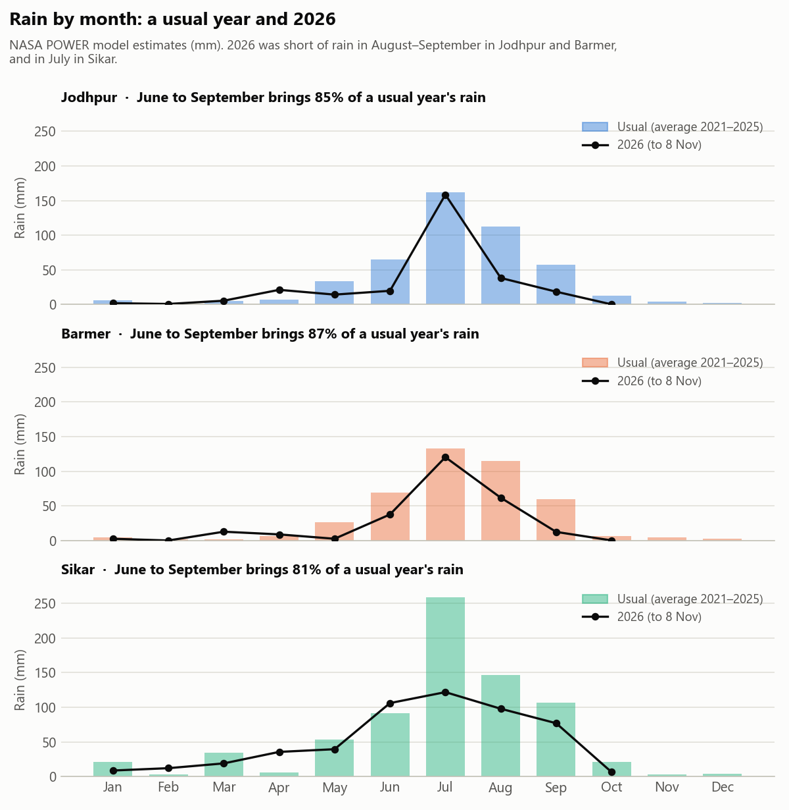
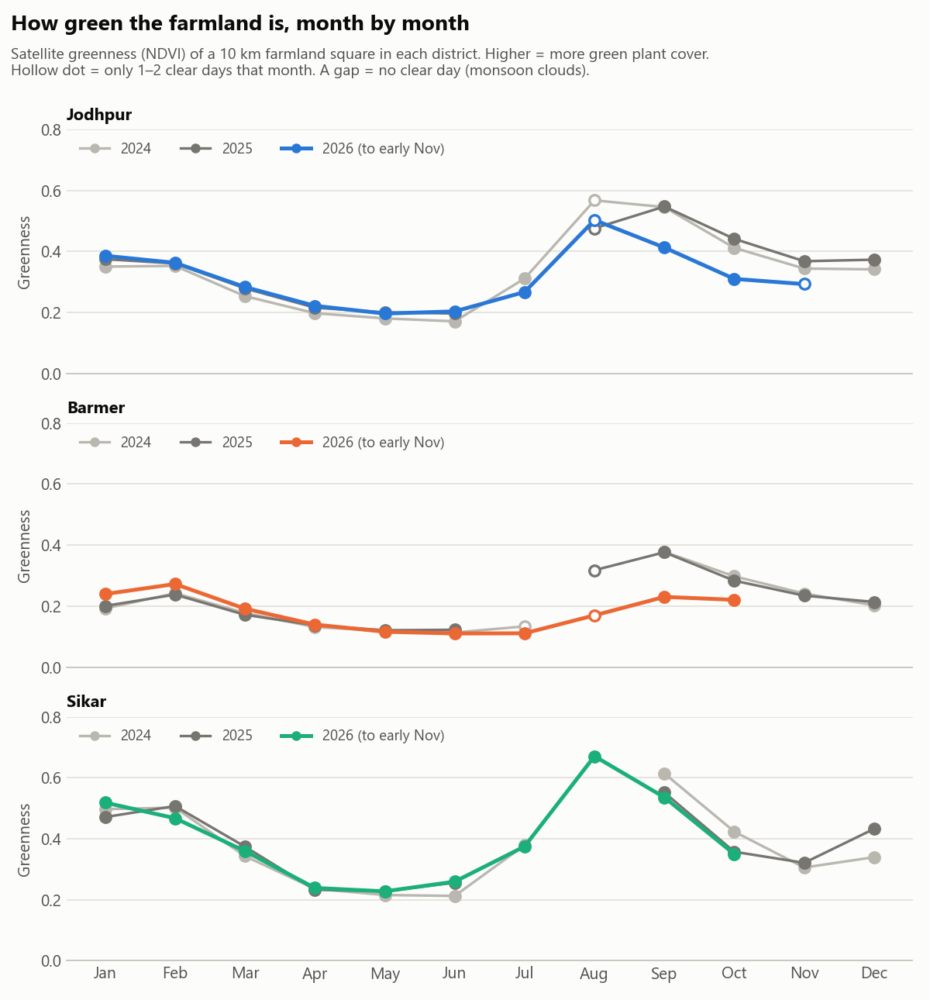

# DesertCrop Navigator: Results Report

**Last updated:** 12 November 2026
**Data in this report:** the app's data file created 11 November 2026, from farmland squares in each district. Rain and temperature run from 1 January 2021 to 8 November 2026; satellite greenness runs from 1 January 2024 to early November 2026. The month-by-month and "same dates" comparisons also use NASA POWER's daily values for the same points (fetched 12 November 2026). Their yearly totals match the data file exactly.
**Districts:** Jodhpur, Barmer, Sikar (Rajasthan)

---

## At a glance

- **2026 has been a dry year.** From 1 January to 8 November, rain was about **60%** of the usual amount for those dates in Jodhpur and Barmer, and **70%** in Sikar. That makes 2026 so far the driest of the six years (2021–2026) in all three districts. Jodhpur and Barmer were short of rain mostly in August and September; Sikar was short mostly in July.
- **Fields were less green after this year's monsoon.** In September–October 2026, greenness was about **27% lower** than in 2024–25 in Jodhpur and **31% lower** in Barmer. Sikar was only about 6% lower. This fits the weak monsoon. But satellite greenness cannot tell whether crops were sown late, failed, or were not sown at all.
- **2026 has also been a little hotter.** For the same dates, average daytime highs were 0.7–0.9 °C above the 2021–2025 average. Jodhpur had 71 days of 40 °C or more (usually about 60) and Barmer had 84 (usually about 62). No day reached 45 °C, though, unlike 2022, 2024 and 2025.
- **Sikar gets the most rain and the steadiest rain:** 751 mm a year on average (2021–2025), against 469 mm in Jodhpur and 432 mm in Barmer. Its rain changes least from year to year (10%, against 19% and 22%).
- **Almost all the rain falls from June to September** (81–87% of a usual year). July is the wettest month everywhere.
- **The fields are least green in April–June and greenest in August–September,** after the monsoon. Sikar has a strong second green season in January–February (winter crops), Jodhpur a moderate one, and Barmer a small one.
- **Barmer is the least green all year; Sikar is the greenest.**
- **The data now comes from farmland and is nearly complete.** 1,704 satellite pictures were collected for 2024–2026, and all but one could be read. Monsoon clouds still hide the ground, though: August has only 0–3 clear days a year.
- ⚠️ **Rain and temperature are NASA computer-model estimates, not rain-gauge readings.** Check them against IMD (India Meteorological Department) records before presenting them.

---

## 1. Where the data comes from

| What | Source | Period in the file | What it really measures |
|---|---|---|---|
| Rainfall, daytime high and night-time low temperature | NASA POWER | Every day, 1 Jan 2021 – 8 Nov 2026 | Computer-model estimates for a grid cell about 50 km wide around each point. **Not rain-gauge or weather-station readings.** |
| Soil moisture where roots grow ("root-zone soil wetness") | NASA POWER, from NASA's MERRA-2 computer model | Every day, 1 Jan 2021 – 8 Nov 2026 | A computer-model estimate from 0 (dry) to 1 (soaked). **Not a measurement**, and not from NASA's SMAP soil-moisture satellite. |
| Greenness of the land (NDVI) | NASA HLS satellite pictures (Landsat and Sentinel-2 satellites combined) | 1 Jan 2024 – early Nov 2026 | How green a farmland square about 10 km across looks from space |

Each district is measured at **one farmland sample point**, not across the whole district. Rain, temperature and greenness all come from the same point.

| District | Sample point (latitude, longitude) | Where it is | Share of the square that is fields* |
|---|---|---|---|
| Jodhpur | 26.59° N, 72.97° E | 39 km north of Jodhpur town | 93% |
| Barmer | 26.15° N, 71.35° E | 45 km north of Barmer town | 62% |
| Sikar | 27.46° N, 74.94° E | 26 km south-west of Sikar town | 96% |

\* From the European Space Agency's 2021 land-cover map, used only to choose the place. Each square lies fully inside today's district.

**What "greenness" (NDVI) means:** a score of how green the land looks from space. A score of 0 means no plants, and the higher the score, the more green plant cover. In these squares the monthly values run from about 0.11 (Barmer in the hot months) to about 0.67 (Sikar in August 2026). Greenness shows plant cover. **It is not a harvest or yield estimate.**

---

## 2. Rainfall (NASA POWER model estimates)

### Rain by year

| Year | Jodhpur | Barmer | Sikar |
|---|---|---|---|
| 2021 | 310.1 mm | 282.2 mm | 693.2 mm |
| 2022 | 506.6 mm | 561.7 mm | 633.4 mm |
| 2023 | 572.0 mm | 484.2 mm | 795.3 mm |
| 2024 | 439.2 mm | 452.5 mm | 815.6 mm |
| 2025 | 517.4 mm | 376.9 mm | 816.0 mm |
| **Average 2021–2025** | **469.1 mm** | **431.5 mm** | **750.7 mm** |
| **Typical swing from year to year*** | **19%** | **22%** | **10%** |
| 2026 so far (1 Jan – 8 Nov) | 278.3 mm | 258.5 mm | 524.3 mm |

\* How much a year usually differs from the average, as a share of the average. It uses 2021–2025 only: 2026 is left out because the year is not over. The app treats 30% or more as "high variability" and then favours drought-hardy crops. **None of the three districts reaches 30%.**

### This year compared fairly: the same dates every year

A part-year can't be compared with whole years, so this table adds up the rain from 1 January to 8 November in every year.



| 1 Jan – 8 Nov of | Jodhpur | Barmer | Sikar |
|---|---|---|---|
| 2021 | 298.2 mm | 277.4 mm | 690.4 mm |
| 2022 | 506.5 mm | 561.7 mm | 628.8 mm |
| 2023 | 557.0 mm | 467.9 mm | 791.3 mm |
| 2024 | 438.0 mm | 452.4 mm | 799.3 mm |
| 2025 | 515.5 mm | 366.3 mm | 815.8 mm |
| **2026** | **278.3 mm** | **258.5 mm** | **524.3 mm** |
| Average 2021–2025 | 463.0 mm | 425.1 mm | 745.1 mm |
| **2026 as a share of that average** | **60%** | **61%** | **70%** |

```
Rain from 1 January to 8 November (each █ = 50 mm)

Jodhpur
  2021  ██████              298 mm
  2022  ██████████          507 mm
  2023  ███████████         557 mm
  2024  █████████           438 mm
  2025  ██████████▌         516 mm
  2026  █████▌              278 mm   ← driest

Barmer
  2021  █████▌              277 mm
  2022  ███████████         562 mm
  2023  █████████▌          468 mm
  2024  █████████           452 mm
  2025  ███████▌            366 mm
  2026  █████               259 mm   ← driest

Sikar
  2021  ██████████████      690 mm
  2022  ████████████▌       629 mm
  2023  ████████████████    791 mm
  2024  ████████████████    799 mm
  2025  ████████████████▌   816 mm
  2026  ██████████▌         524 mm   ← driest
```

### Rain by month



| Month | Jodhpur usual | Jodhpur 2026 | Barmer usual | Barmer 2026 | Sikar usual | Sikar 2026 |
|---|---|---|---|---|---|---|
| Jan | 6 | 1.8 | 4 | 2.5 | 21 | 8.7 |
| Feb | 1 | 0.7 | 2 | 0.0 | 3 | 12.1 |
| Mar | 5 | 5.4 | 2 | 12.7 | 35 | 19.0 |
| Apr | 7 | 21.1 | 6 | 8.8 | 6 | 35.6 |
| May | 34 | 14.2 | 27 | 2.5 | 54 | 39.5 |
| Jun | 65 | 19.7 | 70 | 37.6 | 92 | 106.1 |
| Jul | 162 | 158.6 | 133 | 120.3 | 259 | 121.9 |
| Aug | 112 | 38.2 | 115 | 61.7 | 147 | 97.9 |
| Sep | 57 | 18.4 | 59 | 12.4 | 106 | 77.0 |
| Oct | 12 | 0.1 | 6 | 0.1 | 21 | 6.4 |
| Nov | 4 | 0.0 (1–8 Nov) | 4 | 0.0 (1–8 Nov) | 3 | 0.0 (1–8 Nov) |
| Dec | 2 | – | 3 | – | 4 | – |
| **June–September share of a usual year** | **85%** | | **87%** | | **81%** | |

All figures in mm. "Usual" is the 2021–2025 average for that month.

**What it shows**
- **2026 was the driest of the six years in all three districts** for 1 January to 8 November. Jodhpur and Barmer each had about 20 mm less than their previous driest (2021). Sikar had about 105 mm less than its previous driest (2022).
- **Where the 2026 shortfall came from:**
  - **Jodhpur:** July was normal, but June, August and September each had only about a third of their usual rain.
  - **Barmer:** August had about half its usual rain, and September about a fifth.
  - **Sikar:** June was a little wetter than usual, but July had less than half its usual rain, and August and September about two-thirds to three-quarters.
- **The rain comes in one short season.** June to September brings 81–87% of a usual year's rain, and July alone brings about a third. Sikar is the only district with a little winter and spring rain (January and March).
- **Year-to-year swings:** 2021 was the driest full year in Jodhpur and Barmer, with about half the rain of their wettest years (2023 for Jodhpur, 2022 for Barmer). Barmer has had less rain each year since 2022. Five years are too few to call this a trend.
- Even Sikar's driest full year (2022, 633 mm) had more rain than the five-year averages of Jodhpur and Barmer, according to this model.
- **Jodhpur's figures are lower than in the previous version of this report** (average 469 mm, against 529 mm). The new farmland point falls in a different cell of NASA's weather model than the old town point. Barmer's and Sikar's figures did not change, because their new points fall in the same cells as before.

**Before presenting:** these totals may be high for western Rajasthan, so compare them with IMD district rainfall first. No IMD comparison has been done yet, so this report gives no IMD figures.

---

## 3. Heat and soil moisture (NASA POWER model estimates)

Average daytime high (°C), full years:

| Year | Jodhpur | Barmer | Sikar |
|---|---|---|---|
| 2021 | 34.7 | 34.8 | 32.4 |
| 2022 | 34.3 | 34.2 | 32.9 |
| 2023 | 33.3 | 33.6 | 31.8 |
| 2024 | 34.2 | 34.2 | 32.1 |
| 2025 | 33.9 | 34.5 | 32.0 |

Average night-time low (°C), full years:

| Year | Jodhpur | Barmer | Sikar |
|---|---|---|---|
| 2021 | 20.6 | 21.0 | 19.6 |
| 2022 | 20.3 | 20.7 | 19.7 |
| 2023 | 19.7 | 20.6 | 19.0 |
| 2024 | 20.7 | 21.2 | 19.8 |
| 2025 | 20.1 | 21.0 | 19.4 |

### 2026 compared fairly: 1 January to 8 November

| 1 Jan – 8 Nov | Jodhpur | Barmer | Sikar |
|---|---|---|---|
| Average daytime high, usual (2021–2025) | 35.1 °C | 35.3 °C | 33.4 °C |
| Average daytime high, 2026 | 35.9 °C (+0.9) | 36.0 °C (+0.7) | 34.1 °C (+0.7) |
| Average night-time low, usual (2021–2025) | 21.6 °C | 22.1 °C | 20.8 °C |
| Average night-time low, 2026 | 22.3 °C (+0.6) | 22.5 °C (+0.4) | 21.3 °C (+0.4) |
| Days of 40 °C or more, usual | 60 | 62 | 44 |
| Days of 40 °C or more, 2026 | **71** | **84** | 41 |
| Days of 45 °C or more, usual | 5 | 4 | 3 |
| Days of 45 °C or more, 2026 | 0 | 0 | 0 |

Days of 40 °C or more, 1 January to 8 November of each year:

| Year | Jodhpur | Barmer | Sikar |
|---|---|---|---|
| 2021 | 71 | 63 | 34 |
| 2022 | 90 | 85 | 72 |
| 2023 | 19 | 34 | 14 |
| 2024 | 62 | 68 | 49 |
| 2025 | 57 | 62 | 50 |
| 2026 | 71 | 84 | 41 |

**What it shows**
- **Sikar's days are cooler** than Jodhpur's and Barmer's in every year, by 1.3–2.5 °C (about 2 °C on average). **Barmer has the warmest nights** in every year.
- **2026 has been slightly the warmest of the six years by day** for these dates in all three districts. It was less than 0.2 °C above the next warmest year, but 0.7–0.9 °C above the 2021–2025 average. Jodhpur and Barmer had many more days of 40 °C or more than usual. But no day in 2026 reached 45 °C: the hottest was just under 45 °C in Jodhpur and Barmer, and 44 °C in Sikar.
- **The hottest days in these six years were in 2024:** about 49 °C in Jodhpur, 48 °C in Barmer and 47 °C in Sikar (model values).
- **2023 was the coolest year** in all three districts, with the fewest days of 40 °C or more. It was also Jodhpur's wettest year. **2022 had the most days of 40 °C or more** everywhere.
- Yearly averages move only 1–2 °C over these years. That is too short to call a trend.

### When the hot days come

Average number of days of 40 °C or more in each month, 2021–2025 (months not shown had none):

| Month | Jodhpur | Barmer | Sikar |
|---|---|---|---|
| Mar | 3.0 | 2.4 | 1.2 |
| Apr | 14.8 | 14.4 | 9.2 |
| May | 22.2 | 23.8 | 19.4 |
| Jun | 15.4 | 17.0 | 12.6 |
| Jul | 2.6 | 3.2 | 1.4 |
| Aug | 1.4 | 0.2 | 0.0 |
| Sep | 0.4 | 1.4 | 0.0 |
| **Whole year** | **59.8** | **62.4** | **43.8** |

Almost all the hot days come in April–June: about 52 days in Jodhpur, 55 in Barmer and 41 in Sikar. No complete year had any in October–February.

### Soil moisture

Average soil moisture where roots grow, by month, 2021–2025. 0 means dry and 1 means soaked.

| Month | Jodhpur | Barmer | Sikar |
|---|---|---|---|
| Jan | 0.39 | 0.20 | 0.28 |
| Feb | 0.38 | 0.19 | 0.26 |
| Mar | 0.38 | 0.17 | 0.25 |
| Apr | **0.37** (lowest) | **0.16** (lowest) | **0.24** (lowest) |
| May | 0.38 | 0.16 | 0.24 |
| Jun | 0.40 | 0.18 | 0.27 |
| Jul | 0.47 | 0.26 | 0.39 |
| Aug | **0.53** (highest) | 0.31 | 0.46 |
| Sep | 0.51 | **0.31** (highest) | **0.47** (highest) |
| Oct | 0.44 | 0.26 | 0.39 |
| Nov | 0.40 | 0.23 | 0.33 |
| Dec | 0.39 | 0.21 | 0.29 |

**What it shows**
- **The soil is driest in April–May and wettest in August–September** in all three districts, following the monsoon rain.
- **The monsoon moisture fades through October–November,** when winter (rabi) crops are sown. Crops sown then without irrigation depend on what is left of it.
- **In the model, Barmer's soil is the driest all year.** Part of the difference between districts comes from how the model describes each area's soil. Compare the seasons within a district rather than the districts with each other.
- **2026 is not compared with earlier years.** From 1 October 2026, NASA POWER's newest values come from a different NASA model (GEOS-IT instead of MERRA-2). On that day Barmer's soil moisture jumps from 0.20 to 0.37 with no rain, so the newest values are not comparable with earlier years. Rain and temperature show no such jump.

---

## 4. Greenness of the farmland, 2024–2026 (satellite NDVI)



Only pictures in which at least half of the square was clear are used, the same rule the app uses. Where the satellites passed more than once on the same day, those readings are averaged, so each day counts once (see section 5).

### Greenness by season

| District | Season | 2024 | 2025 | 2026 | 2026 compared with 2024–25 |
|---|---|---|---|---|---|
| Jodhpur | Winter crops (Jan–Feb) | 0.35 | 0.37 | 0.38 | +4% |
| Jodhpur | Hot, dry months (Apr–Jun) | 0.18 | 0.21 | 0.21 | +6% |
| Jodhpur | **After the monsoon (Sep–Oct)** | 0.46 | 0.49 | **0.35** | **−27%** |
| Barmer | Winter crops (Jan–Feb) | 0.22 | 0.21 | 0.26 | +18% |
| Barmer | Hot, dry months (Apr–Jun) | 0.12 | 0.13 | 0.12 | −1% |
| Barmer | **After the monsoon (Sep–Oct)** | 0.33 | 0.32 | **0.22** | **−31%** |
| Sikar | Winter crops (Jan–Feb) | 0.50 | 0.49 | 0.49 | 0% |
| Sikar | Hot, dry months (Apr–Jun) | 0.22 | 0.24 | 0.24 | +6% |
| Sikar | After the monsoon (Sep–Oct) | 0.48 | 0.43 | 0.43 | −6% |

```
Greenness after the monsoon, September–October (each █ = 0.025)

Jodhpur
  2024  ██████████████████▌   0.46
  2025  ███████████████████▌  0.49
  2026  ██████████████        0.35   ← weak monsoon

Barmer
  2024  █████████████▌        0.33
  2025  ████████████▌         0.32
  2026  █████████             0.22   ← weak monsoon

Sikar
  2024  ███████████████████   0.48
  2025  █████████████████     0.43
  2026  █████████████████     0.43
```

### Greenness by month

Each figure is the average for that month. The number in brackets is how many clear days it comes from. \* = only 1–2 clear days, so treat it with care. – = no clear day.

**Jodhpur**

| Month | 2024 | 2025 | 2026 |
|---|---|---|---|
| Jan | 0.35 (6) | 0.37 (10) | 0.39 (9) |
| Feb | 0.35 (7) | 0.36 (6) | 0.36 (7) |
| Mar | 0.25 (8) | 0.28 (10) | 0.28 (6) |
| Apr | 0.20 (9) | 0.22 (10) | 0.22 (10) |
| May | 0.18 (9) | 0.20 (9) | 0.20 (11) |
| Jun | 0.17 (8) | 0.20 (6) | 0.20 (9) |
| Jul | 0.31 (4) | – | 0.27 (6) |
| Aug | 0.57\* (1) | 0.48\* (2) | 0.50\* (2) |
| Sep | 0.55 (5) | 0.55 (6) | 0.41 (6) |
| Oct | 0.41 (8) | 0.44 (8) | 0.31 (10) |
| Nov | 0.34 (9) | 0.37 (11) | 0.29\* (2, to 4 Nov) |
| Dec | 0.34 (7) | 0.37 (9) | – |

**Barmer**

| Month | 2024 | 2025 | 2026 |
|---|---|---|---|
| Jan | 0.19 (6) | 0.20 (10) | 0.24 (8) |
| Feb | 0.24 (7) | 0.24 (6) | 0.27 (8) |
| Mar | 0.18 (8) | 0.17 (9) | 0.19 (7) |
| Apr | 0.13 (6) | 0.14 (8) | 0.14 (11) |
| May | 0.12 (9) | 0.12 (11) | 0.12 (11) |
| Jun | 0.11 (7) | 0.12 (6) | 0.11 (10) |
| Jul | 0.13\* (2) | – | 0.11 (5) |
| Aug | – | 0.32\* (2) | 0.17\* (2) |
| Sep | 0.38 (6) | 0.38 (5) | 0.23 (5) |
| Oct | 0.30 (8) | 0.28 (9) | 0.22 (10) |
| Nov | 0.24 (8) | 0.23 (9) | – (last picture 31 Oct) |
| Dec | 0.20 (9) | 0.21 (9) | – |

**Sikar**

| Month | 2024 | 2025 | 2026 |
|---|---|---|---|
| Jan | 0.50 (4) | 0.47 (8) | 0.52 (8) |
| Feb | 0.50 (7) | 0.51 (7) | 0.47 (8) |
| Mar | 0.34 (6) | 0.37 (10) | 0.36 (5) |
| Apr | 0.24 (6) | 0.23 (10) | 0.24 (8) |
| May | 0.22 (9) | 0.23 (10) | 0.23 (10) |
| Jun | 0.21 (5) | 0.26 (5) | 0.26 (10) |
| Jul | 0.38\* (2) | – | 0.37 (4) |
| Aug | – | – | 0.67 (3) |
| Sep | 0.61 (3) | 0.55 (4) | 0.54 (5) |
| Oct | 0.42 (7) | 0.36 (7) | 0.35 (7) |
| Nov | 0.31 (9) | 0.32 (9) | – (last picture 30 Oct) |
| Dec | 0.34 (7) | 0.43 (6) | – |

### Average greenness for the year (the figure the app shows)

| Year | Jodhpur | Barmer | Sikar |
|---|---|---|---|
| 2024 | 0.30 | 0.20 | 0.35 |
| 2025 | 0.33 | 0.20 | 0.36 |
| 2026 so far | 0.29 | 0.18 | 0.37 |

These year averages depend heavily on which months happened to be clear. Sikar's 2026 average, for example, has no November or December yet, and its 2025 average has no July or August. **Compare seasons (the table above), not year averages.**

**What it shows**
- **The hot, dry months (April–June) are the least green** in all three districts, every year. These values hardly change from year to year: about 0.2 in Jodhpur and Sikar, and about 0.12 in Barmer.
- **The fields green up sharply with the monsoon** and are greenest in August–September. Typical values are about 0.55 in Jodhpur, 0.38 in Barmer and 0.54–0.67 in Sikar.
- **Sikar has a strong second green season in January–February** (about 0.50), as green as Jodhpur at its monsoon peak. Jodhpur's winter green-up is moderate (0.35–0.38), and Barmer's is small (0.21–0.26). This fits the winter (rabi) crop season. It has not yet been checked against crop calendars or irrigation information.
- **After the weak 2026 monsoon, Jodhpur and Barmer were clearly less green.** In September–October their greenness was 27% and 31% below 2024–25. In Barmer the fields greened up much less in 2026: the monsoon peak was 0.23 (September), against 0.38 in both earlier years. Sikar was close to normal, and its August 2026 figure (0.67, from 3 clear days) is the highest monthly value in the data.
- **Winter 2025–26 (January–February 2026) was about as green as, or greener than, earlier winters** in all three districts. That season came before this year's poor monsoon.
- **Barmer is the least green in every season.**

---

## 5. Data coverage and quality

### Rainfall and temperature
**Complete.** Every day from 1 January 2021 to 8 November 2026 has a value for all three districts, with no gaps.

### Satellite greenness

| District, year | Pictures read | Different dates | From Sentinel-2 / Landsat | Pictures the app uses (at least half clear) | Dates those come from | Typical share of the square that was clear | Longest stretch with no usable picture | Pictures that could not be read |
|---|---|---|---|---|---|---|---|---|
| Jodhpur 2024 | 232 | 112 | 144 / 88 | 167 (72%) | 81 | 100% | 30 days (20 Jul – 19 Aug) | 0 |
| Jodhpur 2025 | 244 | 115 | 160 / 84 | 180 (74%) | 87 | 100% | 46 days (22 Jun – 7 Aug) | 0 |
| Jodhpur 2026 (to 4 Nov) | 216 | 101 | 142 / 74 | 168 (78%) | 78 | 100% | 17 days (30 Jul – 16 Aug) | 1 |
| Barmer 2024 | 215 | 101 | 132 / 83 | 162 (75%) | 76 | 100% | 50 days (18 Jul – 6 Sep) | 0 |
| Barmer 2025 | 250 | 112 | 163 / 87 | 186 (74%) | 84 | 100% | 59 days (19 Jun – 17 Aug) | 0 |
| Barmer 2026 (to 31 Oct) | 213 | 101 | 139 / 74 | 161 (76%) | 77 | 100% | 18 days (9 Aug – 27 Aug) | 0 |
| Sikar 2024 | 113 | 105 | 69 / 44 | 72 (64%) | 65 | 99% | 64 days (20 Jul – 22 Sep) | 0 |
| Sikar 2025 | 118 | 111 | 78 / 40 | 80 (68%) | 76 | 99% | 85 days (15 Jun – 8 Sep) | 0 |
| Sikar 2026 (to 30 Oct) | 102 | 95 | 63 / 39 | 72 (71%) | 68 | 99% | 37 days (18 Jul – 24 Aug) | 0 |

How clear the square was, in number of pictures:

| District, year | Nothing clear | Under 10% clear | 10–49% clear | 50–89% clear | 90–100% clear |
|---|---|---|---|---|---|
| Jodhpur 2024 | 26 | 20 | 19 | 19 | 148 |
| Jodhpur 2025 | 34 | 16 | 14 | 27 | 153 |
| Jodhpur 2026 | 20 | 14 | 14 | 13 | 155 |
| Barmer 2024 | 17 | 16 | 20 | 19 | 143 |
| Barmer 2025 | 22 | 22 | 20 | 13 | 173 |
| Barmer 2026 | 14 | 13 | 25 | 20 | 141 |
| Sikar 2024 | 14 | 10 | 17 | 7 | 65 |
| Sikar 2025 | 16 | 9 | 13 | 8 | 72 |
| Sikar 2026 | 12 | 9 | 9 | 10 | 62 |

**Notes**
- **Almost every picture was read.** 1 of 1,704 pictures could not be read (Jodhpur, 2026). Every year was collected in the same way, with the corrected cloud filter, so the years can be compared.
- **Most pictures are clear.** About 6 in 10 pictures show 90–100% of the square clear, and about 1 in 10 shows nothing clear.
- **Clouds still hide the monsoon.** The longest stretches without a usable picture fall in June–September. August has only 0–3 clear days a year in every district, and Sikar had none at all from 15 June to 8 September 2025. The main crop-growing season is therefore the least covered. In 2026 the gaps were shorter, which fits a monsoon with fewer rainy, cloudy days.
- **The same satellite pass is often counted twice in Jodhpur and Barmer.** Their squares sit where two satellite picture tiles overlap, so one pass usually gives 2 readings. That is why they have about twice as many pictures as dates, while Sikar mostly has one picture per date.
  - **In Barmer** the two readings agree almost exactly (typical difference 0.001, largest 0.02).
  - **In Jodhpur** they differ more (typical difference 0.03, largest 0.12). This is probably because one of the two tiles covers only part of the square, but it has not been confirmed.
  - The app counts both readings. This report counts each date once, by averaging that day's readings. The two ways differ by at most 0.01 in the year averages.
- **Sikar has fewer pictures than before,** because its new square sits inside a single satellite tile. It has 65–76 clear dates a year, a little fewer than Jodhpur and Barmer (76–87).

---

## 6. The three districts side by side

| | Jodhpur | Barmer | Sikar |
|---|---|---|---|
| Average rain per year (2021–2025) | 469 mm | 432 mm | 751 mm |
| Driest / wettest full year | 2021 (310 mm) / 2023 (572 mm) | 2021 (282 mm) / 2022 (562 mm) | 2022 (633 mm) / 2024–25 (816 mm) |
| Typical swing from year to year | 19% | 22% | 10% |
| Rain 1 Jan – 8 Nov 2026, as a share of usual | 60% | 61% | 70% |
| Average daytime high, range across 2021–2025 | 33.3–34.7 °C | 33.6–34.8 °C | 31.8–32.9 °C |
| Average night-time low, range across 2021–2025 | 19.7–20.7 °C | 20.6–21.2 °C | 19.0–19.8 °C |
| Days of 40 °C or more (1 Jan – 8 Nov), usual / 2026 | 60 / 71 | 62 / 84 | 44 / 41 |
| Greenest time | September (about 0.55) | September (about 0.38) | August–September (0.54–0.67) |
| Least green time | May–June (0.17–0.20) | May–July (0.11–0.12) | April–June (0.21–0.26) |
| Winter green-up (Jan–Feb) | Moderate (0.35–0.38) | Small (0.21–0.26) | Strong (0.49–0.50) |
| Greenness after the 2026 monsoon, compared with 2024–25 | −27% | −31% | −6% |

In short, Barmer is the driest and least green of the three, and its fields depend most on the monsoon. Jodhpur is in the middle, with rain that swings a lot. Sikar is wetter, cooler and steadier, and green in both seasons. In the dry year 2026, Jodhpur's and Barmer's fields suffered clearly, while Sikar's held up.

---

## 7. Old town squares and new farmland squares

Until 11 November, greenness was measured on squares centred on the three towns. A map check showed that Jodhpur's town square was mostly city. The squares were therefore moved onto farmland (see section 1). This table compares the two in 2024, the one year both cover.

| 2024 | Jodhpur town | Jodhpur farmland | Barmer town | Barmer farmland | Sikar town | Sikar farmland |
|---|---|---|---|---|---|---|
| Year average (the app's figure) | 0.30 | 0.30 | 0.24 | 0.20 | 0.34 | 0.35 |
| Winter crops (Jan–Feb) | 0.30 | 0.35 | 0.22 | 0.22 | 0.46 | 0.50 |
| Hot, dry months (Apr–Jun) | 0.22 | 0.18 | 0.16 | 0.12 | 0.24 | 0.22 |
| After the monsoon (Sep–Oct) | 0.41 | 0.46 | 0.40 | 0.33 | 0.42 | 0.48 |
| Typical share of the square that was clear | 56% | 100% | 86% | 100% | 84% | 99% |
| Dates with a usable picture | 67 | 81 | 73 | 76 | 90 | 65 |

What covered the old town squares, according to the ESA WorldCover 2021 land-cover map (European Space Agency, not NASA; used only to check where the squares sat):

| Old square | Buildings | Fields (cropland) | Bare ground | Shrubs | Trees |
|---|---|---|---|---|---|
| Jodhpur | 58% | 17% | 4% | 13% | 8% |
| Barmer | 15% | 13% | 42% | 25% | 4% |
| Sikar | 31% | 56% | 1% | 8% | 4% |

**What it shows**
- **In Jodhpur and Sikar, the farmland squares show the crop seasons more clearly.** They are greener in winter and after the monsoon, and browner in the hot months, than the town squares. Over the whole year the averages hardly differ, so the year average alone would have hidden this.
- **Barmer's farmland square is less green than its old town square** in the hot months and after the monsoon, and about the same in winter. The reason has not been checked yet.
- **The farmland squares give cleaner pictures.** Typically 99–100% of the square is clear, against 56–86% before.

---

## 7a. Farmer's own details, soil test and money (no outside data)

These optional parts of the app use **only what the farmer enters**. No NASA, space agency or other data is used, and
the app holds no prices or costs.

| Part | What the farmer enters | How the app uses it |
|---|---|---|
| Farm details | Farming system, investment capacity, credit, market access, labour, risk tolerance | Lowers crops that need high investment (with low capacity, no credit or low risk tolerance), more labour (when labour is scarce), or are perishable (when the market is far). The farming system picks which crops are listed. |
| Soil test | Organic carbon (%), pH, EC (dS/m) from a Soil Health Card | EC above 4 dS/m counts as salty soil (the Soil Health Card rating, ICAR-IISS) and lowers salt-sensitive crops. Organic carbon below 0.5% favours legumes. pH above 8.5 or below 6.5 is flagged for expert advice. |
| Money | Area, cost per acre, expected yield and price, capital cost and its life | Arithmetic only: revenue, cost, net return, break-even price and yield, and the result if price or yield falls 20%. Not a forecast. |

The organic carbon and pH bands are common Indian soil-test classes; they have not yet been checked against the
official Soil Health Card table. All of these rules still need checking by agriculture experts.

## 8. Caveats: please read before presenting

1. **Rainfall and temperature are model estimates, not measurements.** NASA POWER is a modelled product that works in cells about 50 km wide. **Its rain looks too high:** for Jodhpur it gives 469 mm in a usual year (2021–2025), but the official ICAR-CRIDA district plan gives a normal of 263 mm (2003–2008). The periods differ, but the gap is large. Official normals for Barmer and Sikar are still to be found. Use NASA POWER rain to compare years and months within a district, not as the true amount of rain.
2. **One farmland point per district.** Each district is represented by one 10 km farmland square for greenness, and by the model cell around that point for weather. The figures are not district-wide averages.
3. **2026 is a part-year.** Weather runs to 8 November, and greenness to 30 October – 4 November. In this report, 2026 is only compared with the same dates in earlier years.
4. **Greenness covers 2024–2026 only.** Three years show the seasons and one dry year, but they cannot show a trend.
5. **The monsoon months are poorly covered.** August has 0–3 clear days a year, and in some years July has none.
6. **Repeated readings** from overlapping satellite tiles make the app's reading counts for Jodhpur and Barmer about twice the number of separate looks (see section 5).
7. **Greenness is not yield.** It reflects plant cover, crop type, growth stage and bare soil, not harvest size. It also cannot say why a field is less green: late sowing, crop failure, or no sowing at all.
8. **Five to six years of weather** is too short to show a long-term climate trend.
9. **The crop advice in the app** uses starter rules that have not yet been checked against Rajasthan farm advisories.
10. **The newest NASA POWER weeks come from a different model.** From 1 October 2026, NASA POWER fills the newest dates from its near-real-time model (GEOS-IT) until the main model (MERRA-2) catches up. Soil moisture from that date is not comparable with earlier years, so it is not compared. Rain and temperature look continuous, and October rain was close to zero.
11. **Soil moisture is a model estimate,** not a measurement from the ground or from NASA's SMAP satellite.

---

## 9. Still to do (each will change this report)

- Compare rainfall with IMD district records (task 4).
- Use real district boundaries and remove repeated readings (task 6). For Jodhpur, first confirm whether one of the two overlapping tiles sees only part of the square.
- Find out why Barmer's farmland square is less green than the old town square.
- Check the winter green-up and the 2026 drop against local crop calendars and reports.

---

## Change log

| Date | Change |
|---|---|
| 11 Nov 2026 | Report started from the data file created 4 Nov 2026 (rainfall and temperature 2021–2025, greenness 2024). That data file and the data-collection script were brought into the project folder. Older copies were moved to an archive folder. Found that the three sample points may sit on the district towns. |
| 11 Nov 2026 | A map check confirmed that all three sample points are in the town centres. Jodhpur's square is mostly city. |
| 11 Nov 2026 | Decided: measure greenness on farmland squares near each town instead of on the towns. Collect 2024 to now again in one consistent way, so every year is comparable. Stop skipping whole satellite images just because the wider area around the square is cloudy; cloudy spots are still removed one by one. |
| 11 Nov 2026 | Farmland squares chosen and approved. Each square sits fully inside today's district and has the most fields nearby: **Jodhpur** 26.59 N, 72.97 E (93% fields, 39 km north of the town), **Barmer** 26.15 N, 71.35 E (62% fields, 45 km north), **Sikar** 27.46 N, 74.94 E (96% fields, 26 km south-west). Fields were judged from a European Space Agency land-cover map (2021), used only to choose the place; district names come from OpenStreetMap. Rainfall and temperature also come from these points, so each district has one point. |
| 11 Nov 2026 | Started collecting the farmland-square data. Partway through Jodhpur 2026 the computer program stopped suddenly because of an error inside one of its reading tools. Nothing already saved was lost. The collection now restarts by itself from the last saved year, and a year is not saved if too many of its images could not be read. |
| 11 Nov 2026 | **Collection finished for all three districts** (about 11:40 pm), with no further stops. Rain and temperature cover 1 Jan 2021 – 8 Nov 2026; greenness covers 1 Jan 2024 – early Nov 2026. The old town-square greenness readings for Barmer and Sikar were removed. 1 of 1,704 satellite pictures could not be read (Jodhpur, 2026). |
| 12 Nov 2026 | **Report rewritten from the farmland-square data.** Every section is updated. Added: chart pictures; 2026 compared with the same dates in earlier years; rain by month; days of 40 °C or more; greenness by season; old and new squares compared. Moving the points changed Jodhpur's rain and temperature figures (new model cell); Barmer's and Sikar's are unchanged. The earlier open question about which cloud filter made the 2024 numbers is settled: all years were collected again with the corrected filter. |
| 12 Nov 2026 | **The app now matches this report.** It shows 2026 as "so far" and leaves it out of the rain average and year-to-year swing; for Jodhpur that gives 469 mm and 19% instead of 437 mm and 25%. Each time it opens with internet, the app asks NASA for the newest rain and temperature figures. It says when it last checked and how recent the data is, and keeps the last data on the phone for use without internet. Hindi mode is now fully in Hindi, including the crop notes. The Listen (voice) button was removed. |
| 12 Nov 2026 | **The app now compares three crop plans, as the Field Shift brief asks.** A farmer answers three questions: where the field is (phone location or a district tap), what they usually grow in the monsoon and winter seasons, and what water they have. The app then shows a "What NASA sees near you" box using this report's figures: usual rain, rain so far this year, the year-to-year swing, the barest and greenest months, how green fields were after this year's monsoon, and hot days this year. Below it are three plans side by side: what the farmer grows now, a plan that saves water, and a plan that builds soil. Each says why it was picked, the evidence, benefits, what is not known, and what to check with the KVK. The crop rules behind the plans are still unverified starter rules. |
| 12 Nov 2026 | **Added rain by month, hot days and soil moisture** from NASA POWER to the data file (no NASA login needed). Every yearly figure already in the file came out identical. Added the "When the hot days come" and "Soil moisture" tables above and two caveats. Found that NASA POWER switched to a different model for dates from 1 October 2026, so this year's soil moisture is not compared. The app now compares this year with the same months of a usual year (January–October): Jodhpur had 278 mm against a usual 462 mm, and 71 hot days against a usual 60. When a farmer taps "Use my location", it uses NASA weather for their own spot, rounded to about 10 km, instead of the district's farmland point. Greenness still comes from the district's farmland square. |
| 12 Nov 2026 | **NASA data now affects the crop ratings** through two approved rules. The cut-offs are starting suggestions to check with KVK or CAZRI. **Dry year:** if this year's rain so far is below 75% of usual (true in 2026 for all three districts: Jodhpur 60%, Barmer 61%, Sikar 70%), crops that need little water score higher and thirsty crops lower. **Dry area:** where usual rain is below 500 mm a year (Jodhpur 469 mm, Barmer 432 mm; not Sikar, 751 mm) and the field gets rain only, winter crops that need medium water score lower. Each affected crop shows the reason with the NASA figure. In a test of 75 farms with no soil test entered, the ratings differed between Jodhpur and Sikar in 17 and the suggested crops in none. With the example salty, sandy soil, the "Build soil" crops differed in 8. |
| 12 Nov 2026 | **The "Build soil" plan now follows the dry-area rule** (approved). On rain-fed fields in Jodhpur and Barmer, it leaves out winter crops that need medium water, such as gram and mustard, and says so on the card. In the same 75-farm test with no soil test entered, the suggested crops now differ between Jodhpur and Sikar in 13 farms, all rain-fed. For example, for bajra → wheat on rain only, "Build soil" is moth bean → taramira in Jodhpur and Barmer, and bajra → gram in Sikar. |
| 12 Nov 2026 | **"Build soil" and "Save water" are now real alternatives.** After keeping the farmer's own crop, "Build soil" prefers crops different from the "Save water" plan, as long as the plan is still rated at least "Possible" and has no dry-area warning. For rain-fed bajra → wheat in Jodhpur the three plans are now: bajra → wheat (current), moth bean → barley (save water) and guar → taramira (build soil). In a test of 225 cases (75 farms in each of the 3 districts), the two plans share a monsoon crop only when it is the farmer's own crop (18 cases, all moth bean growers). The suggested crops differ between Jodhpur and Sikar in 16 of the 75 farms. |
| 12 Nov 2026 | **Expert desk check and AI-use note drafted** (see EXPERT_CHECK.md and SUBMISSION_AI_NOTE.md). IMD calls rain "deficient" below 80% of normal, so changing the dry-year cut-off from 75% to 80% is suggested. The official normal for Jodhpur is 263 mm, against 469 mm from NASA POWER, which confirms that NASA POWER rain reads high. The 500 mm dry-area line still groups the districts the same way as the official agro-climatic zones (Jodhpur and Barmer in the arid western zone; Sikar not). Basing the rule on the zone instead is suggested. The crop rules still need a KVK or CAZRI check. Nothing in the app has been changed by this check yet. |
| 12 Nov 2026 | **Rules updated after the check (approved).** The dry-year line is now IMD's "deficient" rain: below 80% of usual. The dry-area rule now uses the official Arid Western Zone (Jodhpur and Barmer) instead of 500 mm of NASA rain, so it no longer depends on NASA POWER's high rain figures. Results for 2026 are the same: all three districts count as a dry year, and Jodhpur and Barmer as arid. |
| 12 Nov 2026 | **Added "My farm report" for farmers:** a one-page summary of their field, what NASA sees (usual rain, rain and hot days this year against a usual year, bare months), their three plans with the best one marked, things to watch, good practices, and what to check before changing crops. Farmers can print it, save it as PDF, or share it, in English or Hindi. |
| 12 Nov 2026 | **Crop choice now guided by the app.** On the start screen, each season shows only crops that can suit the area: crops the app's rules rate at least "Possible" with some kind of water, using this year's NASA rain. The winter list follows the monsoon crop chosen, so the same crop family twice (for example moth bean then gram) is left out. With 2026 rain at 60–70% of usual, cotton and wheat drop out of the lists in all three districts. Farmers can still pick any crop under "My crop is not here", which shows the main reason it is a poor fit. |
| 12 Nov 2026 | **Field location:** a "Use my location" button is now always on the home page. When the app opens and the phone is more than 10 km from the saved field, it asks "Is your field here?" instead of changing the place by itself, because farmers often open it away from their field. If location fails, the message now says why (blocked, not found, or too slow) and what to do. |
| 12 Nov 2026 | **"What should I grow next?" answered first.** The plans page now opens with the 3 best crops for the coming season, rated for the farmer's own water and soil after the crop grown before. A new start question asks the soil type (sandy, loamy, heavy) and whether a white salt crust is seen; a crust counts like a salty soil test. Fields with enough irrigation now score +1 for every crop; before, they scored 0, so more water could mean a lower rating. The ranking is by fit, not yield; official district yields are being sourced. |
| 12 Nov 2026 | **Usual yields added** next to each suggested crop, from Government of India crop statistics (Directorate of Economics and Statistics, Area-Production-Yield data, 2018-19 to 2022-23): the district average plus the poorest and best year, in quintals per hectare. Example: bajra in Barmer averages 5.8 q/ha but ranged from 1.4 to 12.2, which shows how much the rain decides the harvest there. Only crops grown on at least 1,000 ha in the district are shown; cotton is left out because its unit in the source is unclear. Taramira, isabgol, cumin and some others have no official figure. |
| 13 Nov 2026 | **Changes from a tester's feedback:** the crop rules are now explained once, on the Crop rules page, with pictures for the farmer's district: this year's rain against a usual year with the 80% "dry year" line (Jodhpur: 278 mm against 462 mm for Jan-Oct, 60%), the arid-zone districts, and rain for each year with the average line. Other pages link there instead of repeating rule text. The crop table spells out the seasons (Kharif, Rabi, Zaid) and explains them in one line. Soil test boxes moved onto the Soil page and are kept on the phone. "Share report" now sends a PDF file. The home page says who the app is for, what it does and how it uses NASA data. |
| 15 Nov 2026 | **Farm details, soil test and money added to the farm report.** The report now also lists the farmer's own answers on the "More farm details" page (farming system, investment, credit, market, labour, risk), the soil-test reading when Soil Health Card numbers are entered, and the money sums when area, yield and price are entered. These parts use only the farmer's own figures, no NASA or other outside data (see section 7a). |
